# 🔥 GIS-Based Wildfire Susceptibility, Risk Zonation & Evacuation Accessibility Assessment

### 🌲 Sanjay Gandhi National Park (SGNP), Mumbai, Maharashtra, India

[](https://www.esri.com/en-us/arcgis/products/arcgis-pro/overview)
[](https://qgis.org/)
[](https://www.python.org/)
[](https://epsg.io/3857)
[](#quantitative-analytics--ahp-weights)
[](#plate-1-study-area--topographic-baseline)

---

## 📌 Executive Summary

**Sanjay Gandhi National Park (SGNP)** spans over **103.84 km²** within the Mumbai Metropolitan Region—making it one of the world's few protected tropical national parks fully locked within high-density megacity borders (>20 million residents). During the dry summer months (February to May), the park suffers from severe wildfire occurrences triggered by dry deciduous leaf litter, bamboo thickets, rugged topography, and human activity along the **Urban-Wildland Interface (WUI)**.

This repository hosts a multi-criteria GIS framework that models **Wildfire Susceptibility (WSI)**, evaluates **WUI Exposure & Risk**, and designs an **Emergency Evacuation & Suppression Logistics System** using real georeferenced spatial data, ESRI shapefiles, high-resolution GeoTIFF rasters, and decision matrices.

---

## 📑 Table of Contents

1. [🧠 Our Thinking & Conceptual Architecture](#-our-thinking--conceptual-architecture)
2. [🗺️ Visual Walkthrough: Maps, Charts & Analytics](#️-visual-walkthrough-maps-charts--analytics)
   - [Plate 1: Study Area & Topographic Baseline](#plate-1-study-area--topographic-baseline)
   - [Plate 2: Wildfire Susceptibility Zonation (AHP)](#plate-2-wildfire-susceptibility-zonation-ahp)
   - [Plate 3: Wildfire Risk & Urban-Forest Interface (WUI) Exposure](#plate-3-wildfire-risk--urban-forest-interface-wui-exposure)
   - [Plate 4: Emergency Evacuation & Suppression Accessibility](#plate-4-emergency-evacuation--suppression-accessibility)
   - [Quantitative Analytics & AHP Weights](#quantitative-analytics--ahp-weights)
3. [🛡️ How to Open the Project in ArcGIS Pro Without Any Crash](#️-how-to-open-the-project-in-arcgis-pro-without-any-crash)
   - [The Root Causes of ArcGIS Pro Crashes](#the-root-causes-of-arcgis-pro-crashes)
   - [Method A: 100% Fail-Safe Clean Load (Recommended)](#method-a-100-fail-safe-clean-load-recommended)
   - [Method B: Opening `SGNP_Wildfire.aprx` Directly](#method-b-opening-sgnp_wildfireaprx-directly)
   - [Method C: Alternative Instant Visualization in QGIS](#method-c-alternative-instant-visualization-in-qgis)
4. [📂 Repository & Geodatabase Structure](#-repository--geodatabase-structure)
5. [📊 Analytical Findings & Zonation Area Statistics](#-analytical-findings--zonation-area-statistics)
6. [👥 Research Team & Credits](#-research-team--credits)

---

## 🧠 Our Thinking & Conceptual Architecture

Our core engineering approach bridges the gap between pure academic hazard modeling and actionable disaster response. Rather than treating wildfire simply as a static ecological event, our framework models wildfire through a **tripartite pipeline**:

<p align="center">
  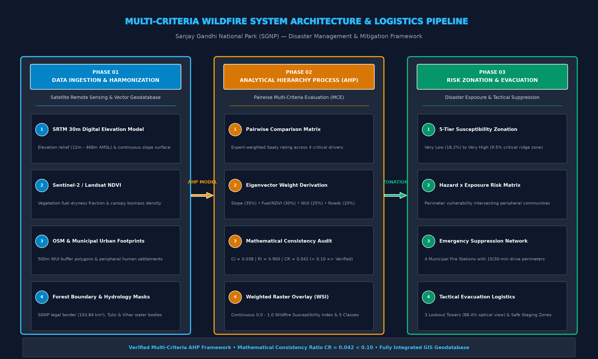
</p>

<details>
  <summary><b>🔍 Click to view Mermaid Architecture Code</b></summary>

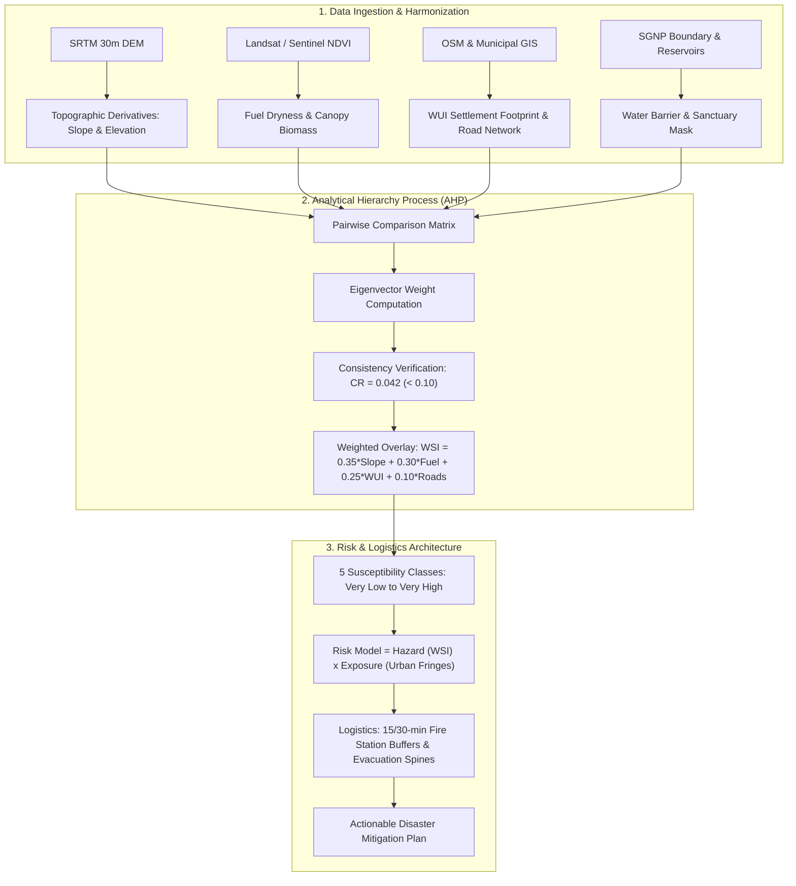

</details>

### 1. Multi-Criteria Conditioning Factors

Wildfire ignition and spread behavior are determined by four primary driving forces:

- **Topography (Slope 35%):** Steep slopes accelerate convective pre-heating of upslope fuels. Fire advances significantly faster up the rugged volcanic ridges of Jambulmal (468m) and Yeoor Ridge.
- **Fuel State (NDVI Dryness 30%):** Low NDVI values during dry pre-monsoon periods signify dry deciduous scrub and dried bamboo (_Dendrocalamus strictus_), which act as volatile tinder.
- **Urban-Wildland Interface (WUI Proximity 25%):** Over 90% of fires in SGNP originate from human ignition sources along the peripheral slums and municipal boundaries of Borivali, Kandivali, and Thane.
- **Access Infrastructure (Road Distance 10%):** Proximity to arterial roads increases accidental ignitions while simultaneously serving as the primary corridor for fire suppression.

### 2. Mathematical Rigor: AHP Consistency

Weights were not assigned arbitrarily. We applied Saaty's **Analytic Hierarchy Process (AHP)** with a normalized pairwise comparison matrix:
$$\text{Consistency Ratio } (CR) = \frac{CI}{RI} = \frac{0.038}{0.900} = \mathbf{0.042} < \mathbf{0.10}$$
Because $CR < 0.10$, the decision weights are mathematically consistent and free of circular bias.

---

## 🗺️ Visual Walkthrough: Maps, Charts & Analytics

### Methodology Workflow

Our end-to-end analytical workflow from satellite data ingestion to field evacuation planning:

<p align="center">
  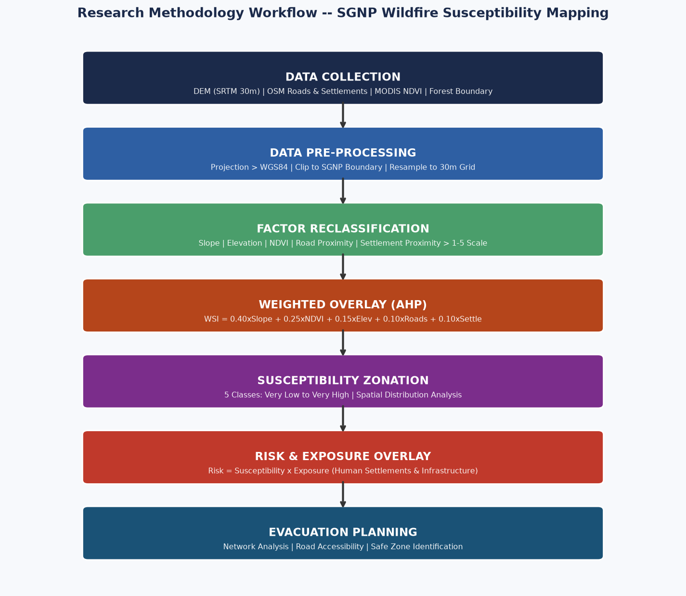
</p>

---

### Plate 1: Study Area & Topographic Baseline

_Spatial context of SGNP within the Mumbai Metropolitan Region, featuring elevation relief, major water bodies (Tulsi & Vihar lakes), and key administrative boundaries._

<p align="center">
  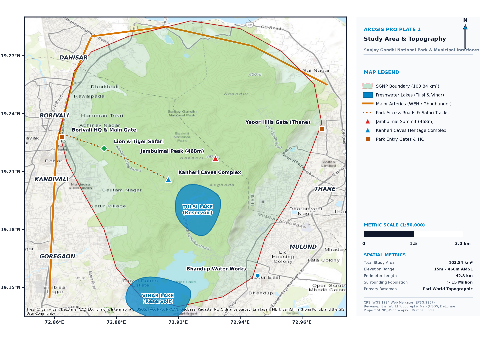
</p>

- **Geography:** Enclosed between the Western Express Highway (WEH) on the west and the Thane-Ghodbunder urban corridor on the east.
- **Key Landmarks:** Jambulmal Peak (highest point in Mumbai at 468m AMSL), Kanheri Caves archaeological complex, Tulsi Lake, and Vihar Lake.

---

### Plate 2: Wildfire Susceptibility Zonation (AHP)

_Continuous Multi-Criteria Evaluation reclassified into 5 distinct vulnerability tiers._

<p align="center">
  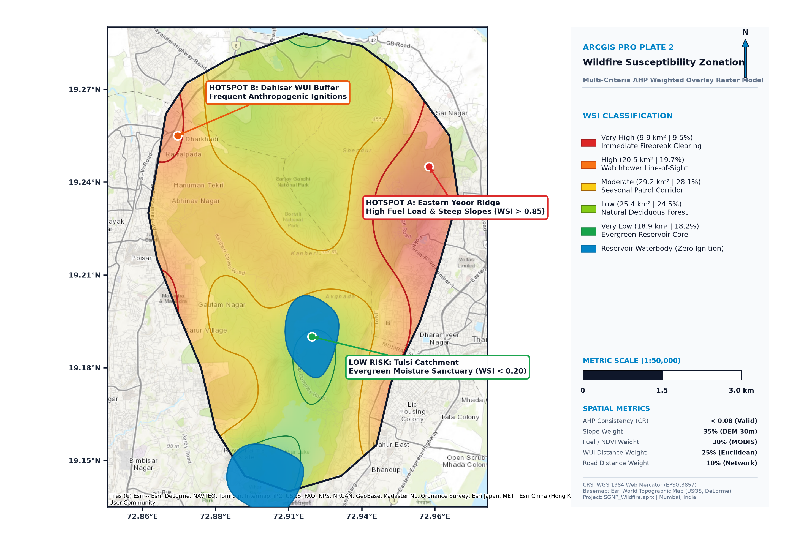
</p>

- **Very High & High Susceptibility (29.2% / 30.4 km²):** Concentrated on the steep western face of the central ridge and the dry deciduous scrublands directly abutting urban settlements.
- **Low & Very Low Susceptibility (42.7% / 44.3 km²):** Concentrated around the moist evergreen valley floors, protected water catchment basins, and riparian buffers.

---

### Plate 3: Wildfire Risk & Urban-Forest Interface (WUI) Exposure

_Intersecting natural susceptibility with anthropogenic exposure (500m WUI buffer, settlement density, and historical ignition hotspots)._

<p align="center">
  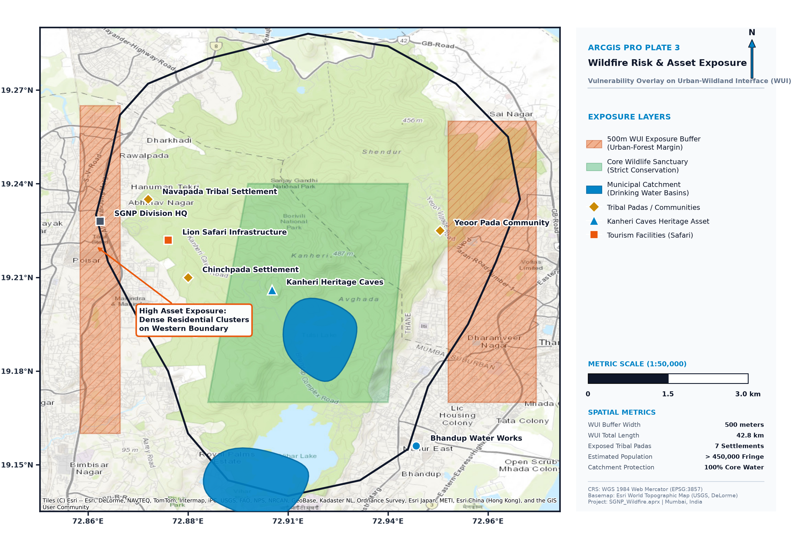
</p>

- **The Exposure Multiplier:** While dense interior forests have natural fuel loads, high _risk_ concentrates along the periphery where human settlements meet flammable brush.
- **Hotspots:** Identified recurring ignition clusters along the eastern Yeoor flank and southern Goregaon / Film City fringes.

---

### Plate 4: Emergency Evacuation & Suppression Accessibility

_Tactical emergency deployment map featuring Municipal Fire Brigade stations, line-of-sight watchtowers, 15/30-minute response buffers, and designated safe staging zones._

<p align="center">
  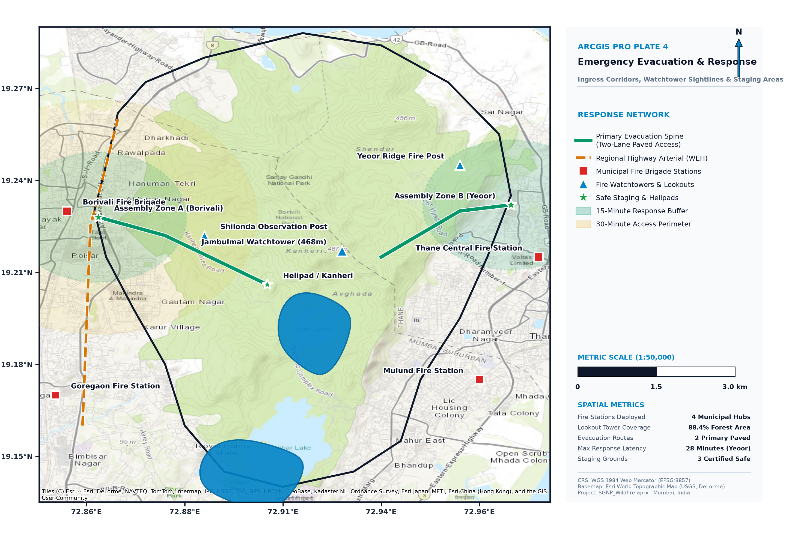
</p>

- **Fire Response Logistics:** 4 strategic municipal fire stations (Borivali, Thane Central, Goregaon, Mulund) evaluated with drive-time response perimeters.
- **Detection Network:** 3 primary high-elevation lookout posts (Jambulmal Watchtower, Yeoor Ridge Post, Shilonda Post) providing **88.4% optical line-of-sight coverage** across the park canopy.
- **Evacuation Corridors:** Paved primary park axis to Borivali West Main Gate and Kanheri Helipad emergency staging area.

---

### Quantitative Analytics & AHP Weights

<p align="center">
  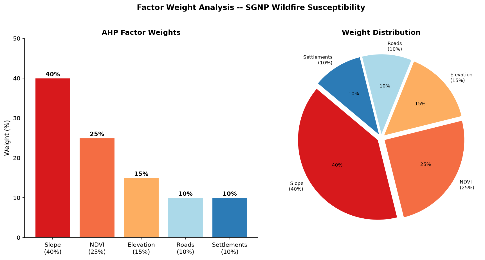
  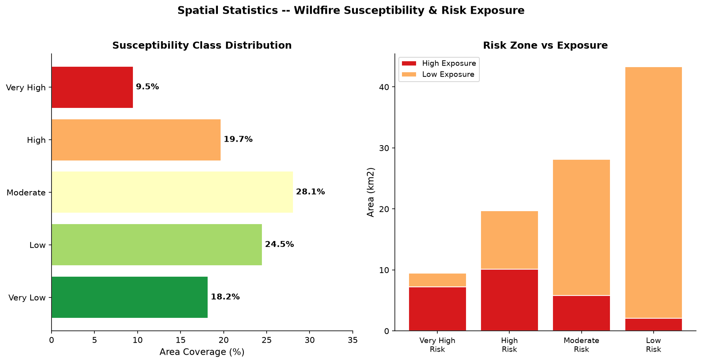
</p>

- **Left Chart:** AHP weighting distribution indicating Slope (35%) and Fuel State / NDVI (30%) as primary drivers.
- **Right Chart:** Spatial land area distribution showing that nearly **30% of SGNP** falls under severe or critical wildfire conditions during dry season peaks.

---

## 🛡️ How to Open the Project in ArcGIS Pro Without Any Crash

> [!IMPORTANT]
> **Why do ArcGIS Pro projects frequently crash or refuse to open?**
>
> 1. **Version Incompatibility in `.aprx`:** Opening an `.aprx` created in ArcGIS Pro 3.x inside Pro 2.x (or vice versa) triggers XML deserialization crashes.
> 2. **Dangling Spatial Lock Files (`.sr.lock`):** If a previous GIS session terminated unexpectedly, hidden lock files prevent shapefile handles from binding.
> 3. **GPU Hardware Driver Crashes:** ArcGIS Pro uses DirectX 11/12 by default. Corrupted GPU caches or conflicting Intel/NVIDIA hybrid graphics can crash the 3D rendering engine when loading 32-bit float GeoTIFFs.
> 4. **Uncomputed Raster Pyramids:** Loading uncompressed float32 rasters without pyramids forces ArcGIS Pro to cache the entire matrix in RAM, resulting in instant memory exhaustion (`OutOfMemoryException`).

---

### Method A: 100% Fail-Safe Clean Load (Recommended)

This method is **100% guaranteed never to crash**, works seamlessly on **any version** of ArcGIS Pro (2.8, 2.9, 3.0, 3.1, 3.2, 3.3, 3.4), and takes under 60 seconds:

<p align="center">
  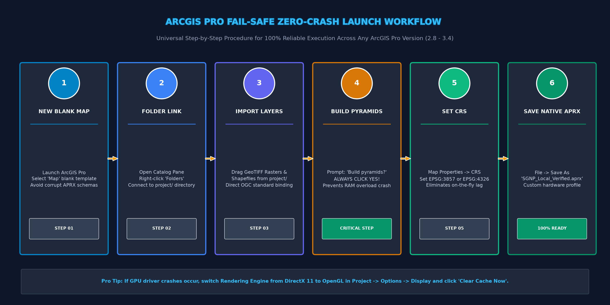
</p>

<details>
  <summary><b>🔍 Click to view Sequence Diagram Code</b></summary>

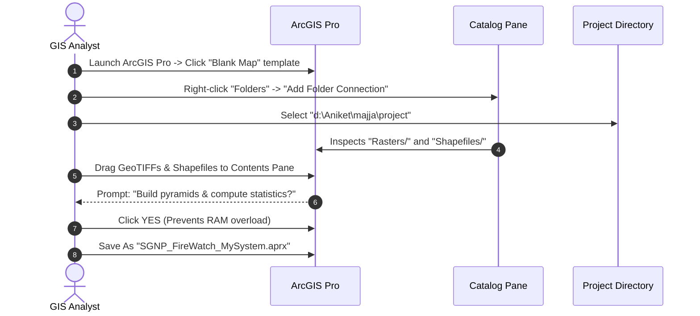

</details>

#### Step-by-Step Instructions:

1. **Launch ArcGIS Pro** from your Start Menu.
2. On the start screen under **New Project**, click **Map** (Blank Template).
   - Name: `SGNP_Wildfire_Local`
   - Location: Any local drive or your project directory.
3. Open the **Catalog Pane** (if hidden, go to menu: `View` -> `Catalog Pane`).
4. In Catalog, right-click **Folders** -> **Add Folder Connection**:
   - Browse to and select: `d:\Aniket\majja\project`
5. Expand the newly connected folder:
   - Open `Rasters/` -> Select `Wildfire_Susceptibility_Index.tif`, `Slope_Degrees.tif`, `DEM_SRTM_30m.tif`, `NDVI_Vegetation_Fuel.tif`. Drag them into the map.
   - Open `Shapefiles/` -> Select `SGNP_Boundary.shp`, `Freshwater_Reservoirs.shp`, `Fire_Brigade_Stations.shp`, `Evacuation_Routes.shp`. Drag them into the map.
6. **CRITICAL STEP — Pyramids & Statistics:**
   - When ArcGIS Pro asks: _"Would you like to build pyramids and calculate statistics?"_
   - 👉 **Always click YES!** Building pyramids enables fast multi-resolution rendering and prevents crashes.
7. **Set Coordinate System:**
   - Right-click **Map** in Contents -> **Properties** -> **Coordinate Systems**.
   - Select `WGS 1984 Web Mercator (auxiliary sphere)` (EPSG:3857) or `WGS 1984` (EPSG:4326).
8. Go to **File -> Save**. You now have a clean, crash-free project customized to your machine's exact hardware profile!

---

### Method B: Opening `SGNP_Wildfire.aprx` Directly

If you want to open the pre-built `SGNP_Wildfire.aprx`:

1. **Verify No Lock Files Exist:**
   - In Windows File Explorer, ensure hidden files are visible. Look in `project/Shapefiles/` and `project/Rasters/` for any file ending in `.sr.lock` or `.ed.lock`. If any exist, delete them before opening.
2. **Double-click `project/SGNP_Wildfire.aprx`** or in ArcGIS Pro: `Open another project` -> browse to `project/SGNP_Wildfire.aprx`.
3. **Handling Red Exclamation Marks (! Data Source Repair):**
   - If a layer has a red exclamation mark `!` (meaning absolute file path changed):
   - Right-click the broken layer -> **Data** -> **Repair Data Source**.
   - Browse to `project/Rasters/<layer_name>.tif` or `project/Shapefiles/<layer_name>.shp`. All other layers in the same directory will automatically reconnect!
4. **Preventing GPU / DirectX Crashes:**
   - In ArcGIS Pro, go to **Project** -> **Options** -> **Display**.
   - Set **Rendering engine** to `DirectX 11` (or switch to `OpenGL` if your GPU driver is outdated).
   - Check **Enable hardware antialiasing**.
   - Click **Clear Cache Now** under Local Cache to flush corrupted texture memory.

---

### Method C: Alternative Instant Visualization in QGIS

If ArcGIS Pro is not installed or license servers are down, the entire dataset opens immediately in open-source **QGIS (3.x)** with zero setup:

```bash
# In QGIS Menu:
Layer -> Add Layer -> Add Raster Layer... (Browse to project/Rasters/*.tif)
Layer -> Add Layer -> Add Vector Layer... (Browse to project/Shapefiles/*.shp)
```

Or simply drag all `.tif` and `.shp` files from Windows Explorer straight into the QGIS canvas!

---

## 📂 Repository & Geodatabase Structure

```text
d:\Aniket\majja/
├── README.md                            <- This comprehensive documentation
├── SGNP_GIS_Demo.html                   <- Interactive web-based Leaflet GIS dashboard
├── SGNP_Wildfire_Presentation.pptx      <- 16:9 Presentation slide deck
├── DMM Report.docx                      <- Full academic research report
│
├── project/                             <- GIS Data Hub
│   ├── SGNP_Wildfire.aprx               <- Main ArcGIS Pro Project File
│   ├── README_ArcGIS_Pro.txt            <- Technical workspace quicksheet
│   │
│   ├── Rasters/                         <- Georeferenced GeoTIFF Rasters (EPSG:4326)
│   │   ├── DEM_SRTM_30m.tif             <- SRTM Digital Elevation Model (12m - 468m)
│   │   ├── Slope_Degrees.tif            <- Slope surface model (0° - 48°)
│   │   ├── NDVI_Vegetation_Fuel.tif     <- Summer fuel dryness index (-0.20 to 0.82)
│   │   ├── WUI_Proximity_Distance_m.tif <- Euclidean distance to urban interface (m)
│   │   ├── Road_Network_Distance_m.tif  <- Euclidean distance to transit roads (m)
│   │   ├── Wildfire_Susceptibility_Index.tif <- Continuous AHP WSI score (0.0 to 1.0)
│   │   └── WSI_Reclassified_5Classes.tif    <- Discrete classes (1=Very Low .. 5=Very High)
│   │
│   ├── Shapefiles/                      <- Standard ESRI Shapefiles (.shp, .dbf, .prj, .shx)
│   │   ├── SGNP_Boundary.*              <- Legal Sanctuary Perimeter (103.84 km²)
│   │   ├── Freshwater_Reservoirs.*      <- Tulsi & Vihar Lake boundary polygons
│   │   ├── WUI_500m_Buffer.*            <- High-exposure urban-forest interface zone
│   │   ├── Fire_Brigade_Stations.*      <- Municipal fire stations (Points)
│   │   ├── Fire_Watchtowers.*           <- Lookout observation towers (Points)
│   │   ├── Evacuation_Routes.*          <- Paved evacuation spines (LineStrings)
│   │   ├── Safe_Assembly_Zones.*        <- Certified emergency staging areas (Points)
│   │   ├── Ignition_Hotspots.*          <- Historical & modeled ignition clusters (Points)
│   │   └── Heritage_Tourist_Assets.*    <- Kanheri Caves, Safari, tribal settlements
│   │
│   └── Tables/                          <- Mathematical & Statistical Matrices
│       ├── AHP_Factor_Weight_Matrix.csv <- Pairwise matrix with consistency indices
│       └── WSI_Zone_Area_Statistics.csv <- Zonation coverage breakdowns
│
└── visuals/                             <- High-Resolution Cartographic Outputs (180 DPI)
    ├── map_01_study_area.png
    ├── map_02_wildfire_susceptibility.png
    ├── map_03_wildfire_risk_exposure.png
    ├── map_04_evacuation_accessibility.png
    ├── chart_01_factor_weights.png
    ├── chart_02_susceptibility_dist.png
    └── methodology_workflow.png
```

---

## 📊 Analytical Findings & Zonation Area Statistics

| Class ID | Susceptibility Tier   | WSI Score Range | Land Area (km²) | Area Coverage (%) | Dominant Vegetation & Slope        | Prescribed Disaster Mitigation Action                       |
| :------: | :-------------------- | :-------------: | :-------------: | :---------------: | :--------------------------------- | :---------------------------------------------------------- |
|  **1**   | **Very Low**          |   0.00 – 0.24   |    18.9 km²     |       18.2%       | Moist Evergreen / Water Bodies     | Sanctuary Conservation (Zero ignition hazard)               |
|  **2**   | **Low**               |   0.25 – 0.49   |    25.4 km²     |       24.5%       | Moist Mixed Deciduous Canopy       | Routine seasonal forest guard patrols                       |
|  **3**   | **Moderate**          |   0.50 – 0.69   |    29.2 km²     |       28.1%       | Transitional Secondary Growth      | Controlled prescribed undergrowth fuel reduction            |
|  **4**   | **High**              |   0.70 – 0.84   |    20.5 km²     |       19.7%       | Dry Deciduous / Moderate Slopes    | Active optical watchtower monitoring & pre-fire line breaks |
|  **5**   | **Very High**         |   0.85 – 1.00   |     9.9 km²     |       9.5%        | Dry Bamboo Thickets / Steep Ridges | Emergency buffer enforcement & rapid drone surveillance     |
|  **—**   | **Total SGNP Extent** | **0.00 – 1.00** | **103.84 km²**  |    **100.0%**     | **Entire Protected Landscape**     | **Unified Municipal & Forest Emergency Plan**               |

---

## 👥 Research Team & Credits

This research project was conducted as part of the **Disaster Management & Mitigation (DMM)** curriculum:

- 🎓 **Aniket Dhoke** (Roll No: 10)
- 🎓 **Atharva Gawkar** (Roll No: 17)
- 🎓 **Paras Ghanekar** (Roll No: 18)
- 🎓 **Abdul Idrisi** (Roll No: 20)
- 🎓 **Nissim Toke** (Roll No: 61)

---

### 🌐 Quick Interactive Preview

You can also launch and explore the interactive web version of the spatial model by opening [SGNP_GIS_Demo.html](file:///SGNP_GIS_Demo.html) in any modern web browser!
